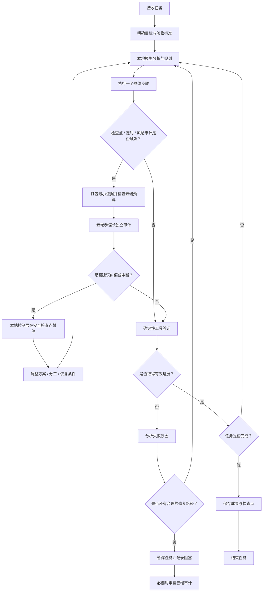

# PACS 本地自主工作闭环与云端参谋长职责

**状态：** DESIGN CLARIFICATION — NOT DEPLOYED  
**日期：** 2026-11-18  
**适用范围：** PACS on Mac mini M4 16 GiB + DeepSeek Harness  
**前置决策：** 本地模型部署拓扑（一个或两个、具体模型与运行时）仍待单独完成评估。本文件不预设双模型常驻，也不授权安装或启动模型。

## 1. 目标

PACS 应当成为一个能够持续推进任务、使用确定性工具执行、通过证据验证结果，并在必要时请求云端高级审计的本地工作系统。

优化目标按优先级排列：

1. 任务质量与结果正确性；
2. 统一内存、系统稳定性与数据安全；
3. 每单位计算时间产生的有效进展；
4. 云端费用与长期维护复杂度；
5. 响应速度。

Mac mini 计划 24 小时运行，因此允许夜间任务采用较长的推理和验证时间。长时间运行本身不构成进展；每个阶段必须产生新证据、可验收成果或明确的阻塞结论。

## 2. 执行角色

### 2.1 本地 PACS 工作系统

本地系统是日常持续工作的主体，负责：

- 持久化任务目标、验收标准、依赖、当前阶段和检查点；
- 调用选定的本地推理模型（模型数量与具体型号待决策）；
- 优先使用确定性工具完成文件、搜索、解析、计算、Git、测试和状态写入；
- 执行任务、验证结果、保存证据、恢复中断任务；
- 对重试次数、执行时间、内存、温度、并发和权限实施本地约束。

本地模型可以承担复杂推理、规划、代码分析和多步骤问题求解。不得预设本地模型只能处理简单任务，也不得预设云端模型在所有任务上质量更高。

### 2.2 DeepSeek Harness 云端模型：高级参谋长与审计专员

云端模型是稀缺的战略与监督资源，不是日常高频执行主力。其职责包括：

- **战略规划：** 对重大任务制定总体思路、方案比较、关键路径和验收重点；
- **阶段审计：** 在约定检查点抽查本地执行过程、证据质量和目标偏离；
- **定时抽查：** 对持续时间较长或风险较高的任务，按风险和预算安排低频审计；
- **异常升级：** 本地反复失败、无有效进展、证据矛盾或风险升高时，独立分析根因并提出纠偏方案；
- **方案纠偏：** 必要时请求暂停、在安全检查点中断、调整计划或重新分配任务；
- **质量复核：** 对重要阶段成果进行独立检查，而不是复述本地模型的自我评价。

云端审计不是每一步都发生，也不应因例行汇报频繁打断本地工作。审计优先采用阶段检查点、风险触发和低频定时抽查。

云端模型可以提出暂停、取消、重排或重新规划请求；实际任务中断、工具调用和系统操作由本地 PACS 控制层依据任务状态、权限策略和安全检查点执行。云端模型不能自行扩大权限、绕过审批或直接获得 root / unrestricted shell。

所有云端调用必须通过统一 Spend Guard。当前预算基线约为 **¥2.00 / 本地自然日**；应优先提交压缩后的任务摘要、已尝试步骤、客观证据、当前判断和明确审计问题，避免传输冗长的重复上下文。无预算或费用无法可靠界定时，拒绝新的付费调用。

### 2.3 确定性工具与本地权限控制层

确定性工具负责可精确执行的工作，不把简单操作交给模型反复推理。权限控制层负责：

- 工具白名单、路径范围和数据分类；
- 风险等级、审批门槛和不可逆操作保护；
- 任务取消、暂停、恢复和超时；
- 本地模型与云端模型的调用预算；
- 日志、证据来源、执行身份和审计记录。

模型输出是建议或任务内容，不是权限授权，也不是执行成功的证据。

## 3. 本地自主执行闭环

### 3.1 有效进展定义

以下情况可以记为有效进展：

- 产生并通过验收的代码、文档、数据或配置成果；
- 获得能够排除或确认假设的新证据；
- 找到根因并形成可复现说明；
- 完成测试并取得明确结果；
- 证明当前路线不可行，并留下足以支持决策的证据。

以下情况不能单独记为有效进展：

- 重复同一分析而没有新增证据；
- 重复执行同一失败方案；
- 只增加输出文本长度；
- 没有新输入或新证据的循环自我审查；
- 仅由模型声明“已完成”，但没有外部验证。

### 3.2 停止与恢复

- 每个任务必须定义交付物、验收标准和停止条件。
- 初始默认采用有限修复尝试；连续失败后必须重新评估，不得无限重试。
- 无合理下一步时转为 BLOCKED / REVIEW_REQUIRED，保存阻塞原因和已完成工作。
- 长任务必须持久化检查点；重启后先恢复状态，不得默认从头执行。
- 任务取消、超时或内存压力触发后，应在安全边界停止并保存可恢复状态。

## 4. 云端审计触发策略

采用三类触发，不采用每步调用云端的模式：

1. **阶段检查点：** 重大阶段完成、重要方案确定或准备进行高影响变更前；
2. **风险触发：** 反复失败、进展停滞、证据冲突、权限边界不清、内存压力或数据风险上升；
3. **低频定时抽查：** 对长时间运行的任务按风险等级和剩余预算抽样审计。

审计结果应包含：发现的问题、证据引用、影响范围、建议动作、是否建议暂停、恢复条件。普通审计建议可以进入下一安全检查点执行；紧急风险可请求立即暂停，但仍由本地控制层完成安全中断。

定时审计的具体间隔、单任务审计次数和费用预留策略应在本地模型部署决策与 Spend Guard 验证后确定，不在本文件中虚构固定频率。

## 5. 本地模型部署决策边界

本文件不决定本地部署一个还是两个模型。模型部署决策必须先于自主工作机制的实现，并至少比较：

- 单模型常驻的固定内存成本；
- 双模型同时常驻时的权重、Runtime、Allocator Cache、上下文状态、Scratch 和启动峰值；
- 单模型按需加载与卸载第二模型的代价；
- 模型空闲时的 keep-alive / residency 行为；
- 每个候选模型在 PACS 代表性任务上的质量和失败模式；
- 任务分工是否具有不可替代的能力差异；
- 16 GiB 统一内存下的实际非模型基线、安全余量和 Swap / Memory Pressure；
- 24 小时运行条件下，加载等待时间与持续驻留内存的经济性。

模型文件保存在 SSD 不等于模型常驻内存。必须区分磁盘可用、Runtime 已安装、模型已加载、权重/缓存驻留和正在推理五种状态。

只有当第二个模型提供可验证且不可由主力模型或确定性工具经济替代的任务价值时，才考虑同时常驻。若其价值仅在特定任务出现，优先比较按需加载、单模型互斥运行，而不是默认双模型常驻。

## 6. 部署与验收状态

本文件是架构澄清，不代表以下事项已经完成：

- 本地模型数量和型号的最终决策；
- Runtime 安装或模型下载；
- 本地任务队列、自动恢复和审计调度的实现；
- 云端审计触发器与 Spend Guard 的端到端验证；
- 本地权限控制层的完整部署；
- 24 小时无人值守运行验收。

在本地模型部署决策完成前，不应把本闭环绑定到特定模型数量、模型名称或模型服务端点。
